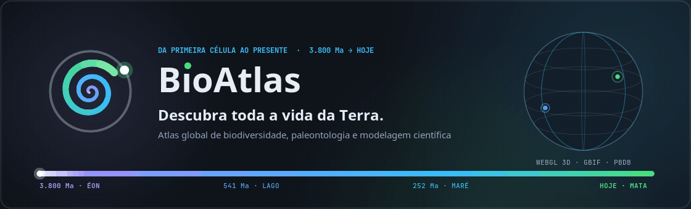
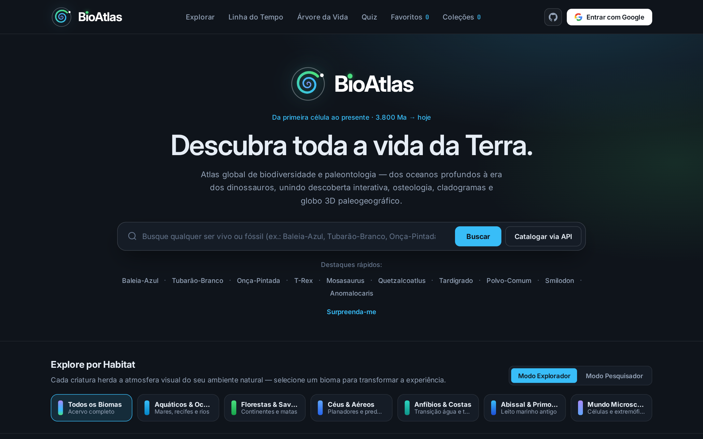
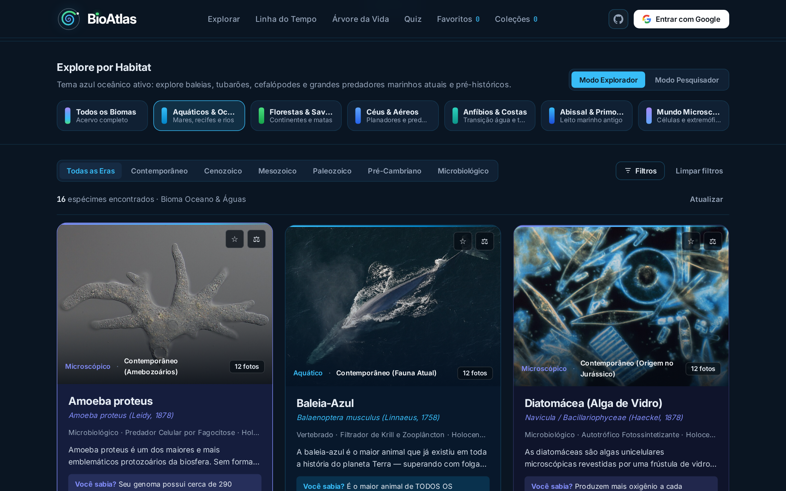
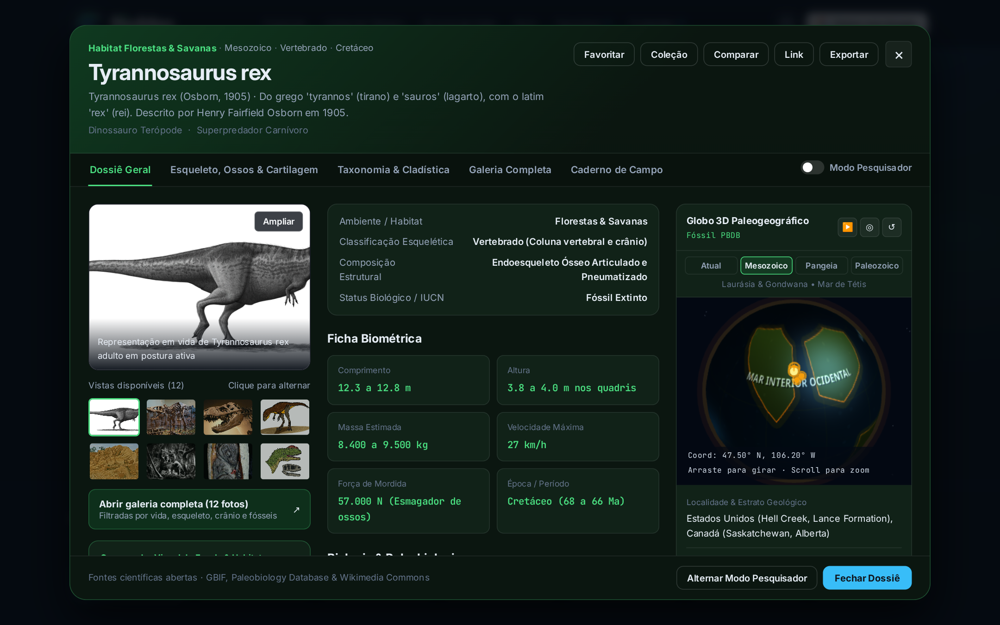
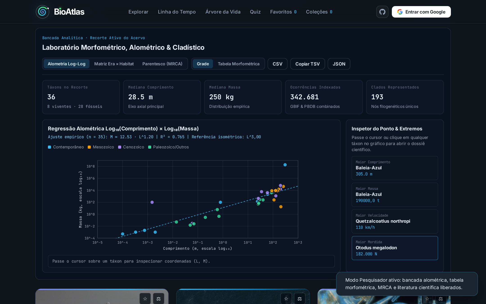
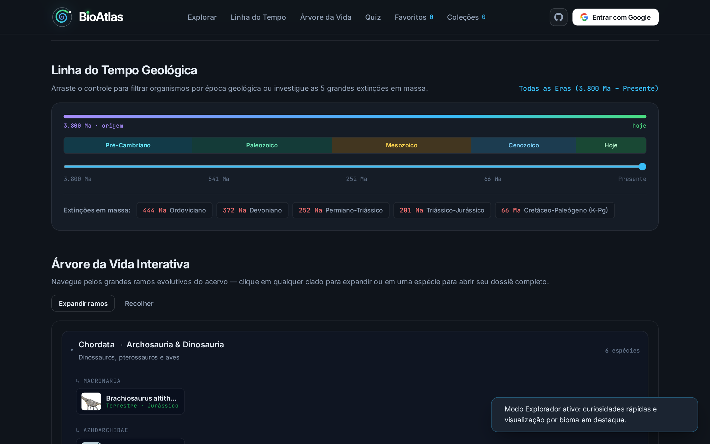
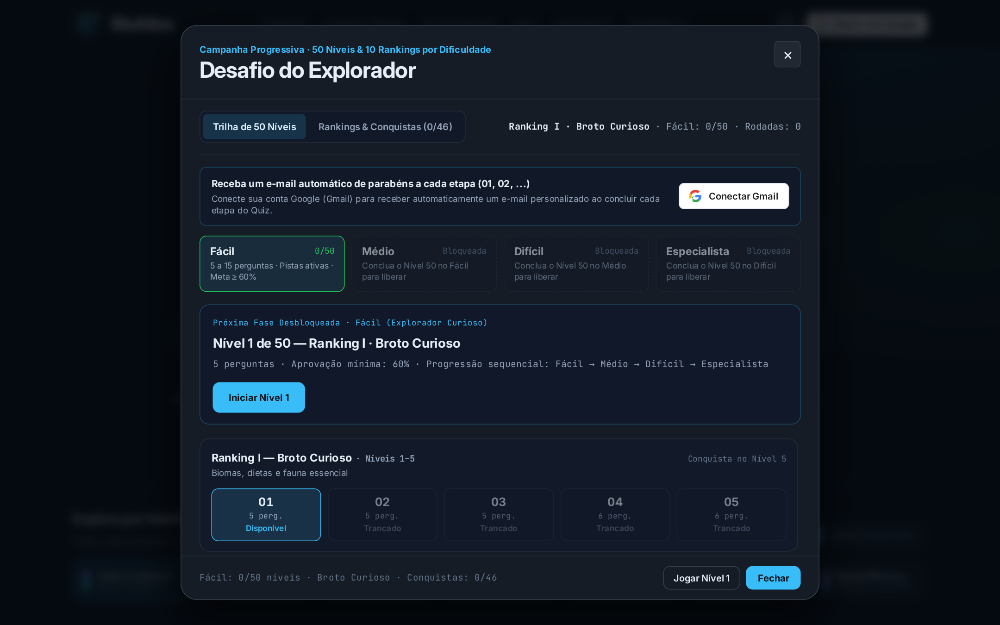
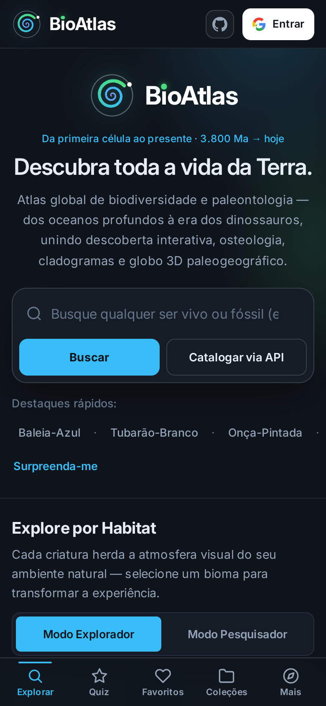
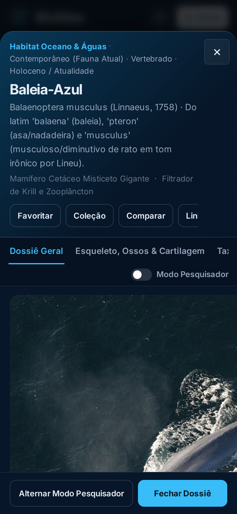
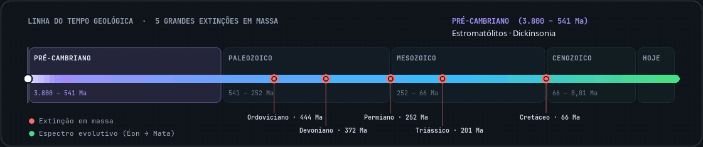

<p align="center">
  
</p>

<p align="center">
  
  
  
  
  
  
</p>

<p align="center">
  <b>Da vida microbiana e dos fósseis pré-cambrianos à fauna de hoje (3.800 Ma → presente).</b><br>
  Plataforma web full-stack de biodiversidade e paleontologia, com dados abertos em tempo real.
</p>

<p align="center">
  <a href="#-início-rápido">Início rápido</a> ·
  <a href="#-telas-da-plataforma">Telas</a> ·
  <a href="#-funcionalidades">Funcionalidades</a> ·
  <a href="#-eras-geológicas">Eras</a> ·
  <a href="#-estrutura-do-projeto">Estrutura</a> ·
  <a href="#-api">API</a> ·
  <a href="#-tecnologias-e-fontes-científicas">Tecnologias</a>
</p>

---

## 🚀 Início rápido

Requisitos: **Node.js 22+** (com `npm`) e um navegador com WebGL (Chrome, Edge, Firefox ou Safari).

```bash
npm install        # instala as dependências
npm run build      # gera o bundle do cliente Firebase e valida o TypeScript
npm run dev        # desenvolvimento  (ou: npm start para produção)
```

Abra `http://localhost:3000`. A porta pode ser alterada pela variável `PORT` no `.env` (modelo em `.env.example`).

<details>
<summary>Outros comandos</summary>

```bash
npm run lint                  # verificação de tipos e regras do Firestore
docker compose up --build     # execução com Docker Compose
```

</details>

---

## 🌟 Visão geral

O BioAtlas atende dois públicos com a mesma base de dados:

| | Modo Explorador | Modo Pesquisador |
|---|---|---|
| **Para quem** | Crianças, estudantes e curiosos | Biólogos, professores e paleontólogos |
| **Experiência** | Atmosfera visual que muda com o bioma, comparador de escala, sons reais da natureza, curiosidades e Quiz de 50 níveis | Bancada analítica em tempo real, modelagem biofísica, ocorrências GBIF/PBDB, artigos revisados por pares e exportação de citações |

Por trás, um motor de ingestão científica via **Server-Sent Events (SSE)** consulta Wikipédia, GBIF, PBDB e Wikimedia Commons, com validação biológica estrita (rejeita personagens fictícios e termos não biológicos) e cobertura fotográfica rica para cada espécime.

---

## 🖼️ Telas da plataforma

### Página inicial e identidade visual

<p align="center">
  
  <br>
  <sub>Tela inicial em tema Abissal com barra de busca unificada, atalhos de espécies e seletor de biomas e modos de leitura.</sub>
</p>

### Experiência desktop — biomas, dossiê 3D, Modo Pesquisador e linha do tempo

| Atmosfera dinâmica por bioma (*Aquáticos & Oceanos*) | Dossiê científico + Globo 3D paleogeográfico (WebGL) |
| :---: | :---: |
|  |  |
| **Modo Pesquisador — bancada analítica e regressão alométrica** | **Linha do tempo geológica e Árvore da Vida** |
|  |  |

### Quiz progressivo (50 níveis) e versão mobile (*touch-first*)

<p align="center">
  
  <br>
  <sub>Campanha progressiva de 50 níveis em 4 dificuldades, rankings exclusivos por nível e envio automático de parabéns via Gmail.</sub>
</p>

<p align="center">
  
  &nbsp;&nbsp;&nbsp;&nbsp;
  
  <br>
  <sub>Interface mobile <i>touch-first</i>: navegação fixa na zona do polegar, carrosséis horizontais e dossiês em formato bottom sheet.</sub>
</p>

---

## ✨ Funcionalidades

<details open>
<summary><b>🎨 Biomas vivos, comparador de escala e bioacústica</b></summary>

- **Atmosfera por habitat**: a paleta da interface e dos dossiês se adapta ao ambiente (Aquáticos e Oceanos, Florestas e Savanas, Céus e Aéreos, Anfíbios e Costas, Abissal e Primordial, Mundo Microscópico).
- **Comparador de escala em silhueta (SVG)**: compara o organismo com um humano adulto (1,75 m), um carro ou um ônibus escolar, e lado a lado com até 3 espécimes.
- **Bioacústica**: player discreto no dossiê com vocalizações reais (baleia-azul, onça-pintada, aves, anfíbios) da Wikimedia Commons, via proxy seguro.
- **Lista Vermelha (IUCN)**: grau real de conservação das espécies atuais (`LC`, `NT`, `VU`, `EN`, `CR`, `EW`, `EX`, `DD`).

</details>

<details>
<summary><b>📸 Galeria científica (10+ fotos por espécime) e lightbox</b></summary>

- Curadoria de pelo menos 10 imagens em alta resolução (960 px+): vida/paleoarte, fotos reais, esqueletos montados, crânios e dentição, fósseis e diagramas anatômicos.
- Lightbox em tela cheia com filtros (*Todas*, *Em Vida*, *Esqueleto*, *Crânio*, *Fósseis*), fita de miniaturas, atalhos de teclado (`←`, `→`, `Esc`) e swipe em telas de toque.

</details>

<details>
<summary><b>🌐 Globo 3D paleogeográfico (Three.js)</b></summary>

- Globo interativo em WebGL com **4 reconstruções paleocontinentais**, escolhidas pela era do espécime: Atual (0 Ma), Mesozoico (110 Ma), Pangeia (250 Ma) e Paleozoico (500 Ma).
- Projeção 3D de ocorrências reais (GBIF para espécies atuais, PBDB para fósseis), animação orbital *Fly-To*, marcadores pulsantes, zoom por scroll ou pinça e inspeção de localidades por toque ou mouse.

</details>

<details>
<summary><b>🔬 Modo Pesquisador e laboratório científico</b></summary>

**Bancada analítica no catálogo**

- KPIs em tempo real do recorte filtrado: táxons, mediana de comprimento e massa, abrangência temporal e registros mapeados.
- **Regressão alométrica log-log interativa**: gráfico SVG de `log10(Comprimento) × log10(Massa)` com ajuste por mínimos quadrados (`M ≈ a · L^b`, com `R²`), legenda por era e inspetor de extremos.
- **Matriz empírica Era × Habitat (heatmap)** com células clicáveis que filtram o catálogo.
- **Calculadora de parentesco cladístico (MRCA)**: ancestral comum mais recente, ramos divergentes e razão morfométrica entre dois táxons.
- Tabela morfométrica ordenável, com exportação em **CSV**, **TSV** (Excel/R/Python) e **JSON**.

**Dossiê científico avançado**

- Matriz taxonômica com links para GBIF, PBDB, Catalogue of Life, NCBI, IUCN e Google Scholar.
- **Perfil morfométrico comparado** (radar SVG de 5 eixos) frente à mediana do acervo.
- **Biofísica alométrica e simulador quadrado-cubo**: taxa metabólica basal (Lei de Kleiber), energia cinética, robustez e escala isométrica (`L × k`).
- Cladograma filogenético clicável, osteologia, biomecânica e histologia.
- Tabela de ocorrências GBIF/PBDB com envelope latitudinal, exportável em **CSV** e **GeoJSON**.
- **Literatura revisada por pares** consultada ao vivo (OpenAlex e Crossref), com DOI, contagem de citações, ordenação e cópia de citação em **ABNT** e **BibTeX**.

</details>

<details>
<summary><b>🏆 Quiz: campanha de 50 níveis e e-mail automático (Gmail)</b></summary>

- 4 dificuldades desbloqueadas em sequência: **Fácil → Médio → Difícil → Especialista**.
- 50 níveis progressivos e 10 rankings exclusivos por dificuldade, com número crescente de perguntas, estrelas e conquistas sincronizadas na conta.
- Com a conta Google conectada (escopo `gmail.send` mantido apenas em memória), cada etapa superada (Etapa 01 a 50) dispara um e-mail de parabéns.

</details>

<details>
<summary><b>🧭 Estudo, descoberta e conta Google (Firebase)</b></summary>

- Linha do tempo geológica interativa (`3.800 Ma → presente`), com filtros para as 5 grandes extinções em massa.
- **Árvore da Vida**: visualização hierárquica por clados, com expansão e recolhimento e abertura direta do dossiê.
- Busca inteligente com autocomplete (miniatura, habitat e época), atalho para catalogação via API e validação de nomes biológicos.
- Links compartilháveis: `?especime=...`, `?habitat=...`, `?modo=researcher`.
- Caderno de campo, favoritos e coleções sincronizados no **Firebase Firestore**, com fallback local quando desconectado.
- Exportação: ficha para impressão/PDF, JSON, CSV e citações em ABNT, APA e BibTeX.

</details>

<details>
<summary><b>📱 Versão mobile (touch-first)</b></summary>

- Navegação inferior fixa (`≤ 860 px`) com *Explorar*, *Quiz*, *Favoritos*, *Coleções* e *Mais*, além de um bottom sheet de atalhos.
- Carrosséis horizontais para biomas, eras, extinções e ferramentas do dossiê.
- Modais em formato bottom sheet, alvos de toque `≥ 44 px`, suporte a `safe-area-inset`, swipe na galeria e pinça no globo 3D.

</details>

---

## 🦕 Eras geológicas

<p align="center">
  
</p>

| Era | Intervalo | Exemplos no acervo |
|---|---|---|
| **Contemporâneo** | Holoceno (0 Ma) | *Balaenoptera musculus* (baleia-azul), *Carcharodon carcharias* (tubarão-branco), *Panthera onca* (onça-pintada), *Orcinus orca* (orca), *Octopus vulgaris* (polvo-comum) |
| **Cenozoico** | 66 – 0,01 Ma | *Smilodon populator*, *Mammuthus primigenius*, *Otodus megalodon*, *Titanoboa cerrejonensis*, *Purussaurus brasiliensis* |
| **Mesozoico** | 252 – 66 Ma | *Tyrannosaurus rex*, *Spinosaurus aegyptiacus*, *Triceratops horridus*, *Velociraptor mongoliensis*, *Mosasaurus*, *Quetzalcoatlus*, *Brachiosaurus* |
| **Paleozoico** | 541 – 252 Ma | *Anomalocaris canadensis*, *Dunkleosteus terrelli*, *Tiktaalik roseae*, *Meganeura monyi*, *Arthropleura armata*, *Dimetrodon limbatus* |
| **Pré-Cambriano** | 3.800 – 541 Ma | Estromatólitos (*Cyanobacteria*), *Dickinsonia costata*, *Charnia masoni*, *Spriggina floundersi* |
| **Microbiológico** | Todas as épocas | *Milnesium tardigradum* (tardígrado), *Paramecium caudatum*, *Amoeba proteus*, *Pithovirus sibericum* |

---

## 📁 Estrutura do projeto

```text
.
├── server.ts                      # Servidor Express (porta 3000), rotas REST e SSE
├── src/
│   ├── client/
│   │   └── firebaseClient.ts      # SDK Firebase (Auth, Firestore) + Gmail API (bundle via esbuild)
│   ├── services/
│   │   ├── knowledgeEngine.ts     # Orquestrador de ingestão e validação biológica
│   │   ├── wikiService.ts         # Wikipédia, Wikimedia Commons e bioacústica
│   │   ├── gbifService.ts         # Taxonomia e ocorrências GBIF
│   │   ├── pbdbService.ts         # Estratigrafia e ocorrências fósseis PBDB
│   │   └── imageProxyCache.ts     # Proxy e cache de imagens científicas
│   ├── eras.ts                    # Metadados das eras geológicas
│   ├── store.ts                   # Catálogo em memória e sincronização de espécimes
│   └── types.ts                   # Tipos TypeScript compartilhados
├── public/
│   ├── index.html                 # Interface principal (desktop e mobile)
│   ├── style.css                  # Design system por bioma, Modo Pesquisador e responsividade
│   ├── app.js                     # Interface, bancada científica, Quiz e UX mobile
│   ├── globe3d.js                 # Globo 3D paleogeográfico (Three.js, mouse e toque)
│   ├── firebase-bundle.js         # Gerado a partir de src/client/firebaseClient.ts
│   └── embedded_catalog.json      # Catálogo embutido de reserva
├── docs/                          # Identidade visual, GIFs e prints demonstrativos deste README
│   └── screenshots/               # Capturas de tela (desktop e mobile) da plataforma em execução
├── firestore.rules                # Regras de segurança do Cloud Firestore
├── firebase-blueprint.json        # Esquema de coleções e entidades do Firestore
├── package.json
├── Dockerfile
└── docker-compose.yml
```

---

## 📡 API

| Método | Rota | Descrição |
|---|---|---|
| `GET` | `/` | Interface web principal |
| `GET` | `/api/eras` | Metadados e limites temporais das eras |
| `GET` | `/api/specimens` | Catálogo filtrável (habitat, era, período, dieta, grupo, esqueleto, clado, busca) |
| `POST` | `/api/specimens/sync` | Sincroniza espécimes customizados catalogados |
| `GET` | `/api/specimens/:identifier` | Dossiê completo (biometria, galeria 10+ fotos, cladograma, osteologia) |
| `POST` | `/api/ingest` | Ingestão científica validada (Wikipédia, GBIF, PBDB, Wikimedia) |
| `GET` | `/api/ingest-stream` | Ingestão em tempo real via SSE (4 etapas) |
| `GET` | `/api/discover` | Sorteio de espécies (geral ou por era) |
| `GET` | `/api/occurrences/:taxon_name` | Coordenadas georreferenciadas (GBIF/PBDB) para o globo e a tabela |
| `GET` | `/api/bioacoustics/:taxon_name` | Gravações reais de sons da natureza (Wikimedia Commons) |
| `GET` | `/api/proxy-image` | Proxy com cache para imagens científicas de alta resolução |
| `GET` | `/api/proxy-audio` | Proxy com suporte a Range para streaming de bioacústica |
| `GET` | `/api/research/:taxon_name` | Artigos revisados por pares com DOI (OpenAlex e Crossref) |
| `GET` | `/api/stats` | Estatísticas globais do acervo |

---

## 🔧 Tecnologias e fontes científicas

| Camada | Stack |
|---|---|
| **Back-end** | Node.js, TypeScript, Express 5, CORS, Server-Sent Events |
| **Front-end** | HTML5 semântico, CSS3 responsivo (touch-first), JavaScript modular, esbuild |
| **3D e visualização** | Three.js (WebGL, texturas paleocontinentais procedurais, Raycaster) e gráficos SVG nativos |
| **Conta, dados e e-mail** | Firebase Authentication (Google Sign-In), Cloud Firestore e Gmail API (`gmail.send`, token OAuth só em memória) |

**Fontes abertas**: [GBIF](https://www.gbif.org/) · [PBDB](https://paleobiodb.org/) · [Wikimedia Commons e Wikipedia](https://commons.wikimedia.org/) · [OpenAlex](https://openalex.org/) · [Crossref](https://www.crossref.org/)

---

## 📄 Licença

Distribuído sob a licença MIT. Os dados científicos e as mídias abertas seguem as licenças de GBIF, PBDB, Wikimedia Commons, OpenAlex e Crossref.

<p align="center">
  <br>
  <sub>Feito por <a href="https://github.com/Sn0wdem">Guilherme Albuquerque Nepomuceno</a></sub>
</p>
